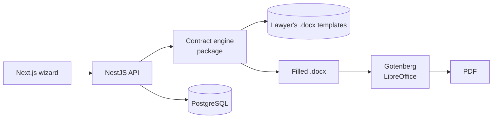

# Contract Generation System — Case Study

> System I designed and built at **Vale Verde Festas** to generate event contracts automatically from the lawyer's own Word templates.
> **Source code is private.** This repository documents the project; a live walkthrough is available on request.

## The problem

Every event contract was assembled by hand: copy the lawyer's template, delete the annexes the client didn't buy, renumber, fill in names, dates, venue and payment terms. It was slow and error-prone — and any change to the legal text risked breaking it.

## The solution

A six-step wizard: choose the venue and services, fill in the client, the event and the payment plan, and the system generates the contract.

- **The legal text stays untouched.** The engine fills the lawyer's original `.docx` instead of re-typing it, so the contract is byte-for-byte the approved wording.
- **Annexes for services not purchased are removed without renumbering the rest**, exactly as the lawyer requires.
- **Validation before generation** — each draft is checked against a per-venue catalog of services and rules.
- **Word and PDF output**; PDF rendered by LibreOffice in a container (Gotenberg).
- **Login, history and template upload per venue**; generated contracts are stored and can be re-downloaded.
- Planned to move inside the company CRM under *Finance → Contracts*.

## Architecture

- **pnpm monorepo** with a standalone `contract-engine` package (template marking, validation, values, rendering) consumed by the API.
- **docxtemplater + PizZip** to fill Word templates without altering the original text.
- **Zod** for input validation, **Argon2** for password hashing, **Prisma** migrations and seeds.
- **Fidelity tests**: generated documents are compared against the originals so the legal text never drifts.

## Scale

- ~88k lines of TypeScript
- 180+ test files, including document-fidelity tests

## My role

Product definition with the legal and sales teams, architecture, engine design, full stack development, tests and documentation.

---
Built by **Victor Sestrem** · [LinkedIn](https://www.linkedin.com/in/victor-sestrem/) · victor-sestrem@hotmail.com
